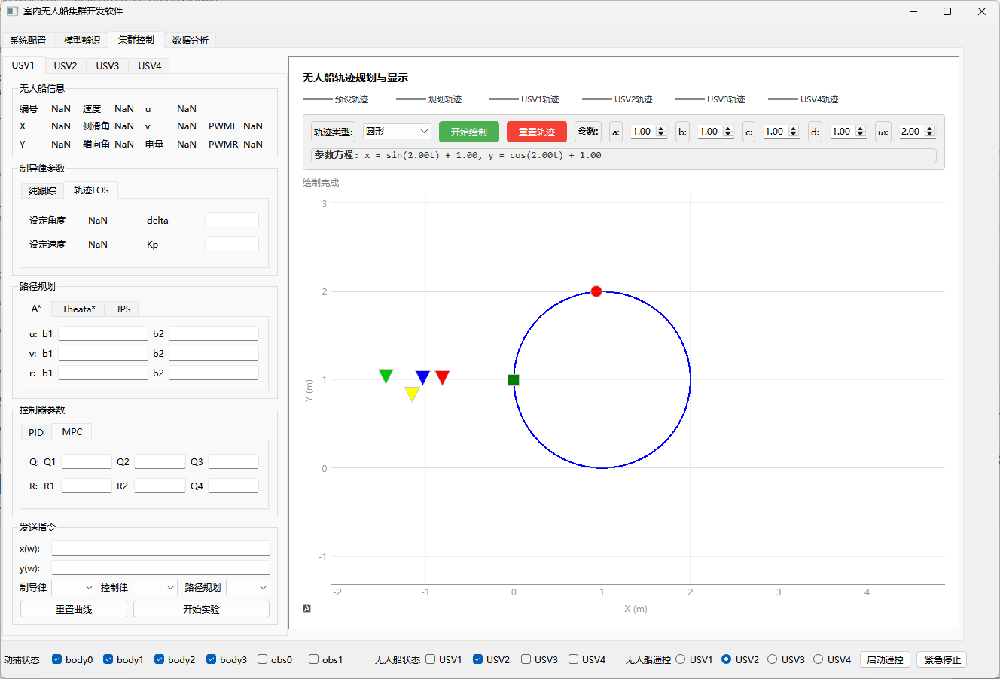
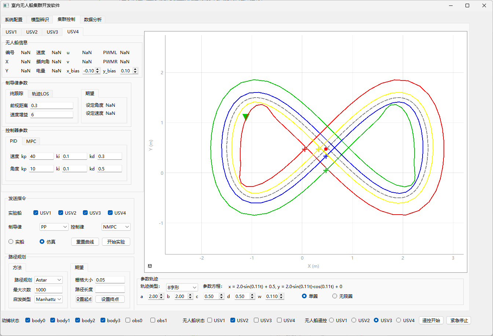
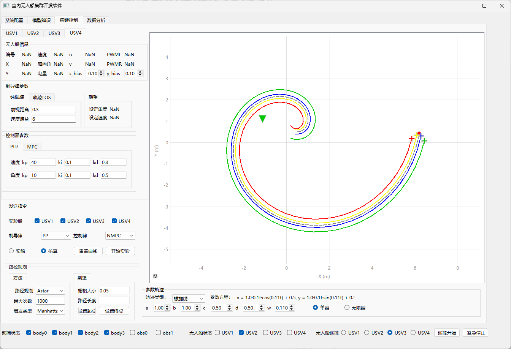

# 室内水池无人船集群测试软件

## 项目简介

本系统是基于QtSide6和Python 3.12.11开发的室内水池无人船集群测试软件，用于实现无人船集群的控制、数据采集和分析。
环境搭建：https://vor2345.blog.csdn.net/article/details/133301589?spm=1011.2415.3001.5331

上位机QTpyside6环境搭建：

```bash
# 创建新的环境
conda create -n poolboat python==3.12.11
# 激活环境
conda activate poolboat
# 删除环境
conda remove -n poolboat --all
# 退出当前环境
conda deactivate
# 更新pip
pip install --upgrade pip -i https://pypi.tuna.tsinghua.edu.cn/simple
# 安装PySide6
pip install pyside6 -i https://pypi.tuna.tsinghua.edu.cn/simple
# 安装其他依赖
pip install numpy pyzmq matplotlib scipy pygame psutil flask flask_socketio pymysql pymssql redis flask_cors pyqtgraph casadi openpyxl certifi -i https://pypi.tuna.tsinghua.edu.cn/simple
```

## 主要功能

1. **系统配置**：无人船参数配置、通信设置、动捕系统配置
2. **模型辨识**：无人船动力学模型辨识、参数估计
3. **集群控制**：非线性模型预测控制(NMPC)、PID控制、遥控器手动控制
4. **数据分析**：数据可视化、性能分析、实验结果导出

## 技术特点

- **反射机制**：参考C#反射机制实现自动配置保存与加载
- **模块化设计**：各功能模块独立，便于扩展和维护
- **实时通信**：UDP通信协议支持高速数据传输
- **动捕集成**：支持ChingmuDLL动捕系统数据采集
- **安全设计**：油门归位检查、自动停止机制保障安全

## 开发日志

### 2025/12/29

- 基于C#反射机制重写了 save_config() 和 load_config() 方法
- 实现自动配置保存与加载，无需手动维护配置文件

### 2025/12/30

- USV状态显示修复，动捕数据解析显示
- 优化动捕数据处理流程，提高数据准确性

### 2026/01/04

- 添加遥控器控制功能（BetaFPV摇杆）
- 实现OTA升级功能
- 优化系统稳定性和安全性

### 2026/01/06

- 添加无人船轨迹显示
- 优化集群控制界面分布
- 添加参数方程系数保存

### 2026/01/07

- **多USV轨迹管理功能实现**：支持4艘USV的独立轨迹计算和动态绘制
- **轨迹显示优化**：将轨迹线宽从1调整为2，提高可视化效果
- **偏移逻辑实现**：基于参考轨迹自体坐标系的位置偏移，考虑角度关系
- **虚拟领航点显示**：添加虚拟领航点原点标记，实时显示参考轨迹位置

### 2026/01/08

- **偏移逻辑修正**：改进相对偏移量到全局偏移量的转换算法
- **USV位置异常修复**：解决更新曲线后USV位置在原点的问题
- **多USV数据结构优化**：通过字典统一管理各USV的激活状态、偏移量和轨迹数据

## 功能演示

### 轨迹显示功能

#### 基本轨迹显示



#### 分离轨迹显示



#### 螺旋线轨迹显示



## 技术实现

### 多USV轨迹管理

本系统实现了多USV轨迹的独立管理和动态绘制功能，主要特点包括：

1. **动态偏移量应用**：基于参考轨迹的方向角，通过旋转变换将跟随者的相对偏移量转换为全局偏移量
2. **参考轨迹方向计算**：采用中心差分法计算参考轨迹在指定时间点的切线方向角
3. **多USV数据结构**：通过字典存储各USV的激活状态、偏移量、轨迹数据及绘制对象
4. **实时更新机制**：使用定时器实现轨迹的实时绘制和更新

### 关键算法

**方向角计算**：

```python
def calculate_leader_direction(self, t):
    delta_t = 0.001
    x1, y1 = self.calculate_point(t - delta_t)
    x2, y2 = self.calculate_point(t + delta_t)
    dx = x2 - x1
    dy = y2 - y1
    angle = np.arctan2(dy, dx)
    return angle
```

**偏移量转换**：

```python
global_x_bias = x_bias * np.cos(reference_angle) - y_bias * np.sin(reference_angle)
global_y_bias = x_bias * np.sin(reference_angle) + y_bias * np.cos(reference_angle)
```

## 设计团队

**Design by**: 刘鹏
**Date**: 2025/12/29 - 2026/01/08

## 技术栈

- **Python 3.8.10**
- **QtSide6**
- **Pygame** (摇杆控制)
- **Ctypes** (DLL调用)
- **UDP通信**

## 主要模块

1. **MainWindow.py**：主界面和系统集成
2. **CommandManager.py**：命令管理与发送
3. **UDPComm.py**：UDP通信模块
4. **USVManager.py**：无人船状态管理
5. **MotionCapture.py**：动捕数据采集
6. **JoystickManager.py**：摇杆控制模块
7. **DataProcessor.py**：数据处理与分析

## 使用说明

1. 配置无人船参数和通信设置
2. 启动动捕系统和UDP通信
3. 选择控制模式（自动/手动）
4. 开始实验和数据采集
5. 分析实验结果并导出数据

## 安全注意事项

- 启动遥控前请确保油门归位
- 实验前检查通信连接
- 紧急情况下使用停止按钮

## 版本历史

- **v1.0**：基础功能实现
- **v1.1**：添加遥控器控制和OTA功能
